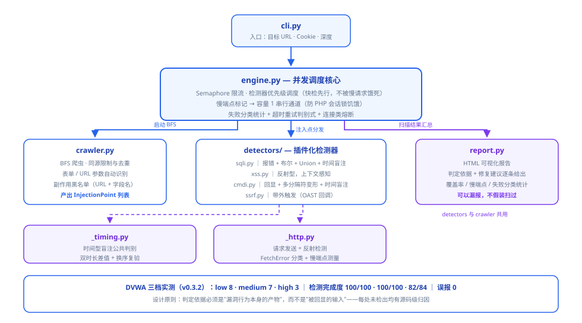

# VulnHunter — Web Vulnerability Scanner

[](https://github.com/yliucherish/vulnhunter/actions/workflows/ci.yml)

> A lightweight, self-built web vulnerability scanner covering automated detection of
> SQL injection, XSS, command injection, SSRF and other OWASP Top 10 issues.
>
> **For authorized security testing and research only.**

## Highlights

- **Async crawler engine**: asyncio + aiohttp, automatic form/URL parameter discovery, same-origin restriction and deduplication, built-in side-effect blacklist (**dual judgment on URL and field names** — password-change/logout forms never enter the injection-point list)
- **SQL injection detection**: error-based (multi-DB error signature library) + boolean blind (normalization + double-run stability check) + **Union injection** (marker context discrimination) + **time-based blind** (dual-latency delta); boolean/time probes cover **both string and numeric contexts** (to handle `escape_string`-style escaping)
- **XSS detection**: reflected XSS with context awareness (separate payloads for HTML text / tag attribute / JS string)
- **Command injection detection**: echo-based (only random arithmetic **results** count) + **multi-delimiter mutation** (`;`/`&&`/`|`/newline/command substitution, to defeat blacklists) + time-based blind (per-delimiter)
- **SSRF detection**: out-of-band trigger (OAST) with a built-in ephemeral callback server — detects even with no response reflection
- **Authenticated scanning**: `--cookie` to inject a session, scan systems behind login (e.g. post-login DVWA pages)
- **Slow-endpoint serial channel**: any injection point exceeding the per-request threshold is marked slow and moved to a capacity-1 serial channel — defends against concurrency starvation caused by target statefulness (PHP session locks). DVWA's 21s captcha black hole once caused 60/100 task timeouts in a full scan (see SPEC pitfall #6)
- **Failure visibility**: request failures are explicitly categorized (timeout/connection/other) and counted; timeouts are classified by `baseline×2 < budget` into "queue contention" (retry once) vs. "inherently slow" (no retry). Reports honestly present coverage and slow endpoints — **a scanner may miss findings, but it must never pretend it scanned**
- **Reporting**: HTML visualization report with vulnerability details, verdict rationale, remediation advice and coverage statistics
- **Extensible rules**: detector plugin architecture — new vulnerability types only require implementing the Detector interface and registering it

## Architecture

```
cli.py → engine.py (concurrency scheduling, Semaphore throttling, unified cookie injection)
           │            · detector priority scheduling (fast checks first, never starved by slow requests)
           │            · slow-endpoint marking → capacity-1 serial channel (anti session-lock starvation)
           │            · failure categorization + connection circuit breaker + timeout retry heuristic
           │            · reports honestly present coverage / slow endpoints
           ├─ crawler.py (BFS, produces InjectionPoint list, side-effect blacklist: URL + field names)
           └─ detectors/ (pluggable)
                ├─ sqli.py   error + boolean + Union + time-based blind
                ├─ xss.py    reflected XSS, context-aware
                ├─ cmdi.py   command injection (echo + mutation + time-based)
                └─ ssrf.py   SSRF (out-of-band trigger)
           ├─ _timing.py    shared time-based blind verdict (dual-latency delta + order-swap re-verification)
           └─ _http.py      request sending + reflection detection + FetchError categorization + slow-endpoint measurement
report.py (HTML report, including coverage and slow-endpoint statistics)
```



**Tests**: `pytest tests/ -v` (15 cases: symmetric true-positive/true-negative detector design +
v0.3.2 scheduling regression — crawler field-name filtering / slow-endpoint marking / serial channel /
retry heuristic / end-to-end scenarios)

## Quick Start

```bash
pip install aiohttp beautifulsoup4

# Basic scan (local lab only — never against unauthorized targets)
python -m vulnhunter.cli http://127.0.0.1:8888 --depth 2 --report report.html

# Authenticated scan (log in via browser first, copy the cookie from devtools)
python -m vulnhunter.cli http://localhost/dvwa --depth 2 \
       --cookie "PHPSESSID=xxxx; security=low"
```

Built-in self-test lab: `python tests/vulnerable_app.py` (listens on 127.0.0.1:8888),
covering five scenarios: XSS / SQL injection / command injection / SSRF / login-required pages.

## Measured Results (DVWA v1.10, v0.3.2)

Full data, source-level miss analysis and three "zero-detection" investigations:
[tests/dvwa_results.md](tests/dvwa_results.md).

Two measurement modes are reported separately (isolating "detection capability"
from "concurrency environment"):

### v0.3.2 rescan data (after Docker recovery, 2026-10-23)

| Security level | Pages crawled | Injection points | Findings (full scan) | Detection completion | Failed requests | False positives |
|---|---|---|---|---|---|---|
| low | 38 | 25 | **8** | **100/100** | **0** | 0 |
| medium | 38 | 25 | **7** | **100/100** | **0** | 0 |
| high | 38 | 21 | **3** | 82/84 | 2 (brute timeout) | 0 |

Both high-level failures are concentrated on the `brute` endpoint (45s/request baseline,
exceeding the 45s timeout ceiling), non-connection failures; all other 82 checks completed.

### v0.3.1 data (legacy, kept to show the scheduling fix's effect)

| Security level | Pages crawled | Injection points | Findings (full scan)* | Findings (targeted)** | False positives | Exploitable-scenario hits (targeted) |
|---|---|---|---|---|---|---|
| low | 26 | 28 | 6 | **7** | 0 | **6/6** |
| medium | 26 | 28 | 5 | **4*** | 0 | 4/6 |
| high | 26 | 25 | 1 (captcha black-hole incident) | **3** | 0 | **3/3** |

> **What the v0.3.2 scheduling fix delivered**:
>
> | Security level | v0.3.1 findings | v0.3.2 findings | Change |
> |---|---|---|---|
> | low | 6 | **8** | +2 |
> | medium | 5 | **7** | +2 (including the previously "under investigation" sqli_blind) |
> | high | 1 (captcha black-hole incident) | **3** | **+2** (including command-injection time-based blind) |
>
> Detection completion across all three levels went from "partial timeout losses" to
> **low/medium 100/100 with 0 failures, high 82/84**.
>
> Two previously questionable points were explained by the rescan:
> - **medium's sqli_blind time-based blind was successfully detected** — it had previously
>   been a casualty of timeouts, not a detection-capability problem;
> - **high level detected command-injection time-based blind** — high level `exec` uses a
>   blacklist stripping `;&|`, and the newline `\n` payload mutation bypassed it successfully,
>   validating the payload mutation strategy.
>
> This in turn confirms the v0.3.2 root-cause analysis:
> **the root cause of missed detections was slow-endpoint serialization timeouts,
> not broken detectors.**

\* Full scan: `--depth 3 --concurrency 4`, real product behavior.
\*\* Targeted re-check: `tests/targeted_check.py`, fresh login session per run, single-point serial, controlled experiment.

> **Every miss has a source-level explanation**: high-level sqli/sqli_blind parameters are
> supplied by session/cookie (no HTTP attack surface); brute has `escape_string` + CSRF;
> mtxMessage is encoded by `htmlspecialchars`. **Being able to explain why something was
> not reported matters more than a pretty number.**

## False-Positive Control Design (the technical focus of this project)

| Vulnerability type | Verdict basis | Anti-false-positive mechanism |
|---|---|---|
| SQL error-based | DB error signature string | Baseline comparison first, excludes natural page errors |
| SQL boolean blind | Tautology/contradiction response difference | Similarity >0.95 AND delta >0.05 required |
| Reflected XSS | Payload reflected without encoding | Canary confirms the reflection point first, then context |
| Command injection | Arithmetic expression **result** appears in response | Payload text itself doesn't count — avoids echo-page false hits |
| SSRF | Local callback server receives request | Unique token per payload, precise attribution |

Design principle: **the verdict basis must be "the product of the vulnerability behavior itself",
not "the echoed input".**

## Technical Blog

Full write-ups of this project's design:

- "Building a SQL Injection Detection Engine from Scratch: False-Positive Control for Error-Based and Boolean Blind Injection" — four techniques (error/Union/boolean/time) and the false-positive control mechanisms earned by stepping on the same pit three times
- "Reflected XSS Automated Detection: Why Your Scanner Has So Many False Positives — Context-Aware Probing" — canary localization → three contexts → "verbatim reflection" verdict; 0 false positives across three DVWA levels

See the [`blog/`](blog/) directory.

## Disclaimer

For educational and authorized penetration testing only. Scanning unauthorized targets
is illegal; users bear full legal responsibility.
